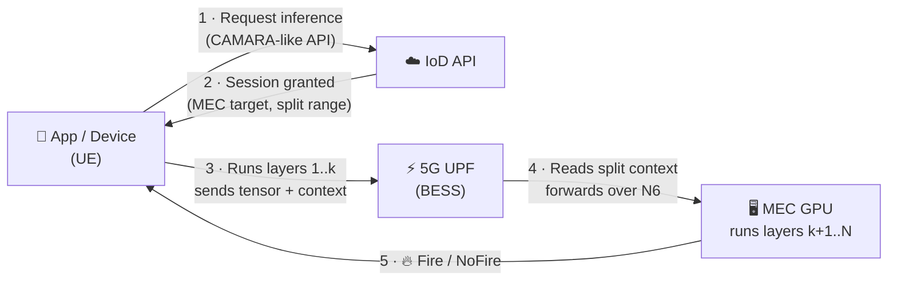

# 🤖📶 Inference on Demand (IoD)

### Exposing AI Inference as a Telco Network API over the 5G User Plane

*Today, an app can ask the mobile network for a better connection on demand.*
*What if it could ask for **AI on demand**?*

[](#-citation)
[](#)
[](#)
[](#)
[](#)

</div>

---

## 💡 The idea in 30 seconds

Mobile operators already expose network capabilities to developers through **[CAMARA](https://camaraproject.org/)** APIs. One of the best known is **Quality on Demand (QoD)**: an app asks the network for a better connection when it needs one.

**IoD asks a different question:** instead of selling *connectivity* on demand, can the network sell *cognition* on demand?

> **QoD sells connectivity on demand. IoD sells inference on demand.**

With IoD, a lightweight device (a drone, a camera, a phone) runs only the **first part** of a neural network. It sends the intermediate result, not the raw image, through the 5G network, and the **edge server (MEC)** finishes the job on a GPU. Where the model is split adapts **in real time** to how loaded the device and the network are.

<div align="center">

| 📱 Device does less | 🌐 Network understands AI | 🔒 Raw images stay home |
|:---:|:---:|:---:|
| Weak devices run real-time AI because the network shares the work | The 5G user plane carries and reads the inference context, not just bytes | Only intermediate tensors travel, never the original frames |

</div>

---

## 🔥 Use case: wildfire detection from drones

A drone flying over a forest captures video and must decide, frame by frame, whether there is fire. Running the whole model on the drone drains its battery; sending every raw frame floods the network. IoD finds the middle ground automatically.

We validate IoD with the **[FLAME 2](https://ieee-dataport.org/open-access/flame-2-fire-detection-and-modeling-aerial-multi-spectral-image-dataset)** aerial dataset (binary *Fire / NoFire* task) and a partitionable **ResNet18** model.

---

## 🧠 How it works



### 1. The split point `k` is the service knob

A neural network is a sequence of layers. IoD cuts it at layer `k`:

| Split | Device effort | Network traffic | When it makes sense |
|:---:|:---:|:---:|:---|
| **Small `k`** (early cut) | 🟢 Low | 🔴 High | Device is weak or busy |
| **Large `k`** (late cut) | 🔴 High | 🟢 Low | Network is congested |

Fixing `k` in advance is too rigid when conditions keep changing. IoD lets the device pick `k` at runtime, inside a range agreed with the network.

### 2. A CAMARA-like API negotiates the "envelope"

The app doesn't micromanage every frame. It requests a model, a latency goal, an allowed split range and a quantization policy, and the network grants a session:

<details>
<summary><b>📄 Example request &amp; response</b></summary>

```json
// --- Service Request ---
{
  "applicationId": "aerial-fire-detection",
  "serviceType": "inference-on-demand",
  "model": {"name": "flame2-yolo-like", "task": "fire-detection"},
  "latencyObjectiveMs": 120,
  "splitPolicy": {"allowedK": [2, 3, 4, 5], "defaultK": 3, "decisionScope": "ue-runtime"},
  "quantization": {"allowed": ["fp16", "int8"], "default": "fp16"},
  "triggers": {"txDelayMs": 22, "headLatencyMs": 80}
}

// --- Session Response ---
{
  "sessionId": "iod-7f31",
  "status": "granted",
  "mecTarget": {"nodeId": "mec-gpu-01", "n6Address": "192.168.90.2", "port": 5001},
  "admittedSplitRange": {"minK": 2, "maxK": 5, "fallbackK": 3},
  "dataPlaneMetadata": {
    "carrier": "SRv6-SRH-TLV",
    "tlvType": 124,
    "fields": ["k", "dtype", "fragmentOffset", "fragmentTotal", "scale", "tensorShape"]
  }
}
```

</details>

### 3. The inference context travels *inside* the packet

Each tensor fragment carries its own metadata in an **SRv6 TLV**, encapsulated in the standard 5G **GTP-U** tunnel:

```
Ethernet / IP / UDP(2152) / GTP-U(TEID) / IPv6 / SRH(+ split TLV) / tensor fragment
```

<details>
<summary><b>🔬 Split TLV layout (experimental type 124)</b></summary>

| Bytes | Field | Meaning |
|:---|:---|:---|
| `[0]` | `k` (uint8) | Selected split point → picks the MEC-side model tail |
| `[1]` | `dtype` (uint8) | `0` = FP32 · `1` = FP16 · `2` = INT8 |
| `[2:4]` | `frag_off` (uint16) | Fragment index |
| `[4:6]` | `frag_total` (uint16) | Total fragments (detects a complete tensor) |
| `[6:10]` | `scale` (float32) | Dequantization scale for INT8 |
| `[10:11]` | `ndim` (uint8) | Number of tensor dimensions |
| `[11:..]` | `shape` (uint16 each) | Tensor dimensions for reconstruction |

</details>

The **UPF** matches the session by TEID, decapsulates GTP-U, reads the TLV, accounts traffic per split point and forwards it to the **MEC**, which reassembles the tensor and completes the inference.

---

## 📊 Key results

Experiments ran on the **[FABRIC](https://portal.fabric-testbed.net/)** testbed with a BESS-based UPF, up to **10 simulated devices** and randomized CPU/network stress injected with **ChaosMesh**.

| | Finding |
|:---:|:---|
| 🎯 | **Finds a balanced operating point on its own**, close to the best static split (`k = 3`), without choosing `k` in advance |
| 📉 | At 10 active devices, the UPF carried **~57 MB per round, about one third of the most network-heavy setup** (`k = 1`, ~172 MB) |
| 🛡️ | **Reacts to congestion**: rounds in "network-protection" mode grew from **7% → 45%** as devices went from 1 → 10 |
| 🔁 | Mean split point shifted from **3.14 → 3.90** under load: IoD alternates regimes instead of replacing one fixed split with another |

> IoD is not a universal minimizer of bytes or compute. It is a **dynamic compromise**: it avoids the heavy traffic of early splits and moves toward network protection when pressure rises.

---

## 🗂️ Repository map

| Folder | What's inside |
|:---|:---|
| [`ue-side/`](ue-side) | Device side: split model head, tensor serialization/quantization, GTP-U/SRv6/TLV packet builder |
| [`upf-side/`](upf-side) | BESS-UPF pipeline adapted to read the split TLV |
| [`mec-side/`](mec-side) | Edge server: tensor reassembly and model tail on GPU |
| [`PFCPSIM/`](PFCPSIM) | PFCP session provisioning (one session/TEID per device) |
| [`chaos-on-ue/`](chaos-on-ue) | ChaosMesh experiments (CPU stress, delay, jitter) |
| [`base_model_training/`](base_model_training) | ResNet18 training on FLAME 2 (weights via Git LFS) |
| [`kubernetes/`](kubernetes) | Cluster manifests |
| [`experiments/`](experiments) · [`results/`](results) · [`paper_outputs/`](paper_outputs) | Experiment scripts, raw results and paper figures |
| [`EXPERIMENTS.md`](EXPERIMENTS.md) | How the experimental campaign was run |

---

## 🚀 Quick start

> **Prerequisites:** Kubernetes with Multus + OVS-CNI, NVIDIA device plugin, a BESS-based UPF, and a NIC wired as the N3 interface. See the detailed bring-up notes for the full environment setup.

```bash
# 1 · Build the device image and import it into containerd
sudo docker build --network=host -t ue-split:local .
sudo docker save ue-split:local | sudo ctr -n k8s.io images import -

# 2 · Deploy the N3 network and 10 device pods (ue-0 … ue-9)
kubectl apply -f network-n3br.yaml
kubectl apply -f ue-statefulset.yaml

# 3 · Provision 10 PFCP sessions on the UPF (TEIDs 10–19)
./setup_pfcpsim_10.sh

# 4 · Fire a device: TEID/IP are derived automatically from the pod ordinal
kubectl exec ue-3 -- python3 /app/ue_sender.py --auto-ordinal \
  --iface net1 --k 3 --quant int8 --loop 5 --fps 5 \
  --next-hop-mac <UPF_N3_MAC>

# 5 · Watch the GTP-U traffic on the N3 link
sudo tcpdump -i <N3_IFACE> -n udp port 2152 -c 5
```

📘 **Detailed bring-up notes** (environment, troubleshooting, design decisions; in Portuguese): [`README_dev_notes_ptBR.md`](README_dev_notes_ptBR.md)

---

## 🛣️ Roadmap

- [ ] Tighter integration with the official CAMARA API framework
- [ ] Policy-driven split selection (beyond threshold triggers)
- [ ] Exercising the compute-protection regimes under device-side pressure
- [ ] Larger multi-tenant MEC deployments

---

## 📝 Citation

If IoD is useful in your work, please cite:

```bibtex
@inproceedings{moreira2027iod,
  title     = {Exposing AI Inference as a Telco Network API over the 5G User Plane},
  author    = {Moreira, Rodrigo and Rodrigues Moreira, Larissa Ferreira and
               Martins, Joberto S. B. and Carvalho, Tereza C. and
               de Oliveira Silva, Fl{\'a}vio},
  booktitle = {IEEE Future Networks World Forum (FNWF)},
  address   = {Lisbon, Portugal},
  year      = {2027}
}
```

---

## 👥 Authors

| | Affiliation |
|:---|:---|
| **Rodrigo Moreira** | Federal University of Viçosa (UFV), Brazil |
| **Larissa Ferreira Rodrigues Moreira** | Federal University of Viçosa (UFV), Brazil |
| **Joberto S. B. Martins** | University of Salvador (UNIFACS), Brazil |
| **Tereza C. Carvalho** | University of São Paulo (USP), Brazil |
| **Flávio de Oliveira Silva** | University of Minho (UMinho), Portugal |

---

## 🙏 Acknowledgments

This work was supported by **FAPEMIG** (Grant #APQ00923-24), **FAPESP** MCTIC/CGI Research Project 2018/23097-3 (SFI2 – Slicing Future Internet Infrastructures), **CAPES** (Finance Code 001), **PROPP/UFU**, and **FCT** within the R&D Unit Project Scope UID/00319/2025 (Centro ALGORITMI, UMinho). We also thank **IMAGINE-B5G** (EU Horizon Europe, Grant No. 101096452) for the experimental infrastructure.

<div align="center">

---

*Future networks won't just move data. They'll help run AI.* 🌐🤖
